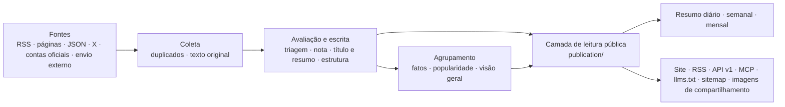

# Arquitetura



## Três processos

| Processo | Onde | O que faz |
|---|---|---|
| api | `apps/api/` | Fastify. Endpoints internos do site (`/api/site/`), API pública (`/api/v1/`), RSS, MCP, endpoints do painel, proxy de imagens, imagens de compartilhamento |
| worker | `apps/worker/` | Fila de tarefas e agendamentos com pg-boss: coleta das fontes, chamadas de modelo, agrupamento, popularidade, resumo diário, alertas, limpeza |
| web | `apps/web/` | Páginas renderizadas no servidor com React Router. Só lê a api por HTTP, sem tocar no banco |

O código de negócio fica em `packages/backend/`, e os tipos e constantes compartilhados entre front e back em `packages/contracts/`. O nome, os textos, a marca e as páginas deste site ficam em `site/`; as categorias, fontes, prompts e limites do setor em `industry/`; os recursos que só este site tem em `modules/` (veja "Módulos" abaixo).

## Regras que não mudam

- **Uma única camada de leitura pública**: site, RSS, API, MCP, sitemap e imagens de compartilhamento leem todos de `packages/backend/src/publication/`. O alcance público, as vagas da seleção (nas saídas para máquinas cada notícia sai uma vez só) e as condições de evidência dos fatos são definidos só em `publication/scope.ts`; saídas novas também seguem as regras atuais de retirada e de permissão de texto completo. Edições já publicadas mantêm o texto daquela edição, mas se uma citação pode ser pública, o nome da fonte e a hora da citação continuam sendo decididos pelos dados atuais; uma retirada também remove a introdução e a capa que dependiam daquela citação.
- **Cache não prolonga a vida de conteúdo velho**: conteúdo mutável é revalidado quando vence o `Cache-Control` da resposta; o cache em processo, em disco e HTTP do sitemap compartilham o mesmo prazo, sem recomeçar a contagem no envio; as respostas HTTP do MCP usam `no-store`. Proxies e CDNs próprios também precisam respeitar isso; veja "Domínio e HTTPS" em [Deploy](deploy.md#domínio-e-https).
- **Página não chama modelo**: abrir uma página só lê resultados que já estão no banco; modelos só são chamados nas tarefas do worker.
- **Requisição paga tem recibo**: toda requisição paga (modelo, X, contas oficiais do WeChat, Jina) registra um recibo antes, e o resultado é salvo antes de ser usado. Se o processo reinicia ou a tarefa é repetida, o resultado já pago é reaproveitado, sem gastar de novo (`providers/receipts.ts`). Um recibo de resultado incerto é liberado automaticamente uma vez depois de 30 minutos; os artigos parados em falha por causa dele voltam para a fila e continuam a extração ou análise que faltava. Se o resultado ficar incerto de novo, o administrador confere na página "Execuções" e libera.
- **Disjuntor de orçamento**: cada serviço pago tem limites por minuto, hora e dia; passou, pausa (painel "Configurações → Limites de requisições pagas").
- **Travas de segurança**: `COLLECT_ENABLED`, `MODEL_CALLS_ENABLED`, `FEISHU_CONTENT_PUSH_ENABLED`, `DINGTALK_CONTENT_PUSH_ENABLED`, `FEISHU_INTERNAL_ENABLED`, `INDEXNOW_SUBMIT_ENABLED` e `BAIDU_PUSH_ENABLED` só decidem "se envia ou não", não qual lógica é usada; só abrem com `true`, e ausentes ficam fechadas. O `.env` gerado por `scripts/init-env.ts` liga coleta e chamadas de modelo; se for mexer só na interface, pode mudar para `false`. Nos testes os envios ficam sempre desligados, e coleta e modelos só falam com serviços falsos locais.
- **Conteúdo público é anônimo**: administradores e visitantes veem o mesmo; itens salvos e lidos do leitor ficam no navegador. O painel é só para administradores.
- **Matéria velha não inunda a tela**: material publicado há mais de 48 horas quando é encontrado, o acervo da primeira importação de uma fonte nova e envios retroativos vão para o arquivo pela data original, sem entrar em "Hoje" e sem envio de notificações; depois da primeira importação, itens mais antigos da lista não são mais recolhidos. Material sem data de publicação confiável fica fora do ar até que a data seja lida.
- **Origem rastreável**: todo destaque leva o link do original; se o site mostra o texto completo depende do `site_fulltext` da fonte, e por padrão só o resumo aparece.
- **Cada módulo mantém suas regras**: o painel chama os módulos de conteúdo, fatos, notificações e recuperação, sem reescrever o estado deles diretamente; módulos de negócio não dependem do painel. Correções manuais são gravadas junto com o resultado público e os registros necessários para recuperação.
- **Interfaces entre processos compartilham tipos**: os endpoints do painel seguem `packages/contracts/src/admin.ts`, e as cargas das tarefas seguem o `JobData` de `jobs/queue.ts`; remetente e destinatário são verificados juntos. O front continua acessando o back só por HTTP.

Essas fronteiras são verificadas por `tests/architecture.test.ts`; ao mudar uma fronteira, atualize a convenção e a verificação juntas. A identidade do site e o modelo de cada etapa vêm de `site/`, e as categorias e prompts do setor vêm de `industry/`; o código não fixa valores de um site específico.

## Pastas

| Onde | O que tem |
|---|---|
| `site/` | O que é deste site: nome e textos, o modelo de cada etapa, marca e logo, páginas de termos, os quatro arquivos fixos da raiz do site (`public/`, publicados depois de trocar os marcadores), o histórico de mudanças e quais módulos estão ligados (`site/modules/`) |
| `industry/` | Pacote do setor: categorias e tags, tópicos, fontes de exemplo, prompts, limites |
| `modules/` | Recursos que só este site tem, uma pasta por recurso (veja "Módulos" abaixo); o framework não traz módulos |
| `packages/backend/src/sources/` | Leitores dos seis tipos de fonte e o agendamento da coleta (`collect.ts`) |
| `packages/backend/src/content/` | Entrada de material, duplicados, extração e limpeza do texto |
| `packages/backend/src/editorial/` | Avaliação e escrita: `analyze.ts` (fluxo), `prompts.ts` (leitura dos prompts), `models.ts` (qual modelo cada etapa usa) |
| `packages/backend/src/events/` | Agrupamento em fatos, popularidade, visão geral dos fatos |
| `packages/backend/src/publication/` | Camada de leitura pública |
| `packages/backend/src/reports/` | Resumos diário, semanal e mensal |
| `packages/backend/src/providers/` | Chamadas de modelo, embeddings, X, contas oficiais do WeChat e Jina; recibos e orçamento |
| `packages/backend/src/notify/` | Envio para o Feishu |
| `packages/backend/src/operations/` | Alertas, backup, limpeza, IndexNow, envio para o Baidu |
| `packages/backend/src/admin/` | Endpoints do painel |
| `apps/web/app/routes/` | Um arquivo por página; a tabela de rotas fica em `apps/web/app/routes.ts` |
| `database/migrations/` | Migrações do banco, executadas e registradas pela ordem do nome completo do arquivo |
| `scripts/` | Scripts de inicialização, migração, dados iniciais, avaliação e verificação |
| `tests/` | Testes do backend (o nome do banco precisa terminar em `_test` ou `_ci`; veja abaixo) |

## Módulos

Um recurso que o framework não tem e só o seu site precisa (um ranking especial ou uma página de monitoramento, por exemplo) vira um módulo: uma pasta por recurso, `modules/<nome>/`, que é um pacote npm chamado `@aihot/<nome>` com seu próprio backend, endpoints, páginas, estilos, migrações e testes.

| Arquivo | O que tem |
|---|---|
| `module.ts` | Os endereços dele: páginas, redirecionamentos e caminhos tratados pela api (tipos em `packages/contracts/src/modules.ts`) |
| `server.ts` | Os pontos em que ele se liga ao backend: endpoints, tarefas agendadas, filas, callbacks de eventos, dados das páginas do painel etc. (`packages/backend/src/modules.ts`, cada ponto diz qual arquivo o lê) |
| `web.tsx` | Os pontos em que ele se liga ao site: páginas, itens de navegação, componentes das páginas de tópico e do painel etc. (`apps/web/app/modules.ts`); componentes que aparecem numa página só fornecem uma função de carga e vêm junto com o código daquela página |
| `migrations/` | As tabelas dele, executadas junto com `database/migrations/` pela ordem do nome do arquivo |
| `tests/` | Os testes dele, rodados pelo `npm test` |
| Outros arquivos | Imagens e outros arquivos estáticos dele também ficam na pasta do módulo: registre a rota no ponto `http` do `server.ts` e envie com o `sendFile` de `apps/api/src/routes/static.ts` (ele cuida do tipo, ETag, cabeçalhos de cache e 404; o nome do arquivo você valida), e coloque o endereço em `apiPaths` no `module.ts` |

Pronto o módulo, liste-o nas três listas de `site/modules/`: `index.ts` para os endereços, `server.ts` para o backend e `web.ts` para o site (não liste na que não se aplica); e coloque-o em `dependencies` no `site/package.json`. Se o deploy é com Docker, acrescente no `Dockerfile`, como os outros pacotes, uma linha `COPY modules/<nome>/package.json modules/<nome>/`. O código do framework não importa nenhum módulo, só lê essas três listas; assim, ao trazer atualizações do repositório original, é difícil haver conflito com seus recursos. Se faltar um ponto de ligação, crie um ponto genérico no framework em vez de escrever o recurso dentro dele.

Módulos oferecem ferramentas MCP por `agent.abilities`. O `scripts/mcp-check.ts` sempre verifica o conjunto completo de ferramentas; um módulo pode informar em `mcp.checkArgs` argumentos de teste que funcionem com o banco vazio. Sem isso, só as ferramentas cujo schema de entrada aceita `{}` são chamadas de verdade com `{}`; as demais só têm a descoberta verificada, sem adivinhar argumentos. O comportamento das ferramentas de um módulo é verificado pelos testes do próprio módulo.

## Migrações do banco

Migrações já publicadas são histórico de deploy: não podem ser reescritas nem apagadas; a correção vai num arquivo novo. Migrações do motor e dos módulos seguem a mesma convenção: rodam pela ordem do nome completo do arquivo e são registradas pelo nome completo; arquivos diferentes com o mesmo número rodam separadamente, e o mesmo nome completo não pode aparecer em duas pastas. A partir de `0055`, cada arquivo tem uma única instrução que possa rodar com o sistema no ar; o PR recusa migrações novas fora da convenção e não permite usar um número menor para escapar da verificação. Isso evita que uma instrução trave uma tabela e, na mesma transação, fique esperando outra tabela ou varrendo muitos dados.

Colunas novas devem ser preferencialmente anuláveis ou com valor padrão constante; CHECK e chaves estrangeiras em tabelas existentes entram primeiro como `NOT VALID` e são validadas em outra migração. Índices usam um `CREATE INDEX CONCURRENTLY IF NOT EXISTS` separado; UPDATE ou DELETE em massa não podem ir numa migração publicada, nem escondidos num DO. Preenchimento de dados é uma operação à parte, em lotes e observável, testada antes numa cópia do backup.

Quando vários filtros são correlacionados e o plano de consulta subestima muito o número de linhas, dá para criar estatísticas MCV conjuntas para essas colunas e, numa migração separada, rodar `ANALYZE` nessas colunas da tabela. Confirme o ganho com a distribuição real antes; não crie estatísticas sem base, nem faça análise do banco inteiro numa migração ou pule tabelas travadas presumindo sucesso.

Mudanças destrutivas, como trocar tipo ou apagar coluna, precisam de passos de atualização e reversão próprios, e do impacto nos dados existentes descrito na [documentação de deploy](deploy.md#atualizar); a verificação de migração online não as libera diretamente. Para uma tabela que o código não usa mais, depois de confirmar que os dados podem ser apagados, escreva num arquivo de migração próprio `DROP TABLE IF EXISTS <tabela>` (sem CASCADE: se ainda houver objetos dependentes, a migração falha) e registre também no guia de deploy. Para ampliar as instruções permitidas, prove antes que ela não bloqueia por muito tempo as requisições em serviço e acrescente as verificações correspondentes; não desligue a verificação nem altere o registro antigo.

## Saídas públicas

Uma relação `related` entre fatos precisa de pelo menos duas matérias que a sustentem quando é criada. O histórico de relações é mantido; se a matéria que liga os dois fatos for retirada explicitamente, perder o direito de ser matéria pública do fato, virar texto de síntese, sair do fato original, ou se um agrupamento posterior negar a relação, ela deixa de aparecer quando sobrarem menos de duas evidências válidas, e pode voltar quando houver evidência suficiente de novo. Matérias que saem naturalmente da janela de busca, ou revisões comuns que mantêm o vínculo, não fazem a relação expirar. Uma relação antiga sem julgamento de ligação verificável não é tratada como retirada só por falta de registro; se o próprio fato não pode ser lido publicamente, ele continua sem ser recomendado. O significado de `storyline` não muda com essa regra, e todas as saídas públicas compartilham as mesmas regras de leitura.

| Endereço | O que tem |
|---|---|
| `/` `/all` `/hot` `/topics` `/daily` `/weekly` `/monthly` | Seleção, todas as notícias, fatos em alta, tópicos, resumos diário, semanal e mensal |
| `/feed.xml` `/feed/full.xml` `/feed/all.xml` `/feed/daily.xml` `/feed/weekly.xml` `/feed/monthly.xml` | RSS: seleção, seleção com texto completo, tudo, diário, semanal, mensal; também há `/feed/category/<key>.xml` por categoria e a versão com texto completo `/feed/full/category/<key>.xml` |
| `/api/v1/` | API pública, documentada em `/openapi-v1.json`; o Markdown para agentes começa em `/api/v1/agent`; a página explicativa é `/agent` |
| `/api/mcp` | Serviço MCP: uma ferramenta para mais recentes, busca, em alta, fatos, diário, semanal e mensal; o prefixo dos nomes é o `mcpPrefix` de `site/site.ts` |
| `/llms.txt` `/sitemap.xml` `/robots.txt` | Instruções para modelos de linguagem e buscadores (`robots.txt` e os outros arquivos da raiz ficam em `site/public/`) |
| `/admin` | Painel |

## Testes

```bash
npm run typecheck
DATABASE_URL=postgres://127.0.0.1:5432/myhot_test npm test
npm run build -w @aihot/web && npm run test:web
```

O nome do banco apontado por `DATABASE_URL` precisa terminar em `_test` ou `_ci`; se não existir, é criado e migrado sozinho. Cada arquivo de teste roda em paralelo numa cópia dele, então a conta do banco precisa de permissão para criar bancos (`CREATEDB`). Os testes não acessam serviço externo nenhum: modelos e APIs pagas são respondidos por serviços falsos locais.
